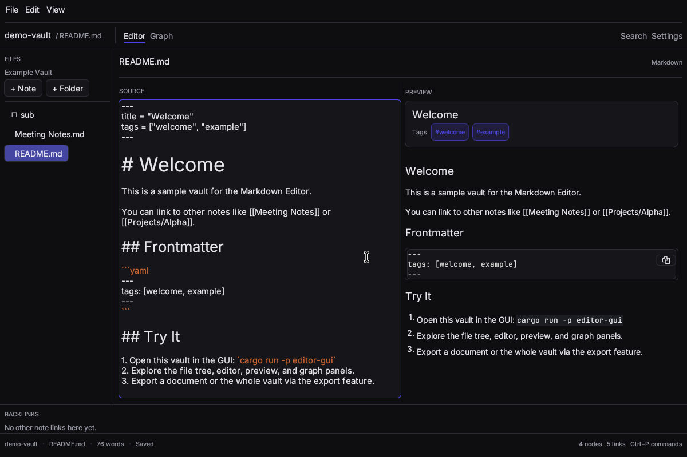

# Markdown Editor

A local-first markdown editor written in Rust. Desktop UI is built with
**eframe/egui**; the storage, parsing, graph, search and export logic lives in
a separate, GUI-independent core crate.

> **Status:** M3 complete. The daily-driver loop is polished: a coherent
> light/dark/system design system, bundled type, YAML or TOML frontmatter, a
> live link graph, backlinks, full-text search, and a background watcher. See
> [docs/roadmap.md](docs/roadmap.md) for what comes next.



## Features

- **Vaults:** open a folder of Markdown files; the last vault and note reopen
  on launch.
- **Editor:** syntax-highlighted Markdown editing with configurable font size,
  dirty-state indicator, and save-on-demand or timed auto-save. Editor and
  graph share one window through tabs.
- **Design:** dark-first indigo palette with neutral surfaces, a matching light
  theme, and true system-theme following. Bundled Inter and JetBrains Mono,
  shared cards/tabs/empty states, styled scrollbars and selection, and a
  persistent status bar with vault, note, word count, save state, and graph
  stats.
- **Preview:** rendered Markdown via `egui_commonmark`, with frontmatter shown
  as a metadata card. Drag the divider to resize editor and preview.
- **File tree:** nested folders with expand/collapse and a context menu for
  new notes/folders, rename, delete, and reveal-in-file-manager.
- **Graph:** a force-directed graph whose edges are wikilinks, with
  degree-sized nodes, arrowheads, hover tooltips, community colouring
  (toggleable), and draggable layout persisted to
  `<vault>/.editor/layout.json`. Links to missing notes appear as grey
  placeholders; clicking one creates and opens the note.
- **Backlinks:** a panel listing notes that link to the open document;
  clicking one opens it.
- **Search:** full-text vault search (tantivy) with snippets and arrow-key /
  Enter navigation. Frontmatter tags are indexed; `#tag` narrows a search, and
  a tag on its own lists every note carrying it.
- **Live updates:** a background watcher applies external edits to the graph
  and index, reloads clean buffers, and shows a conflict banner instead of
  overwriting unsaved edits.
- **Frontmatter:** TOML (`key = value`) or YAML (`key: value`) blocks, including
  block tag lists. Parsing is tolerant and the raw block is preserved on save.
- **Export:** a note to standalone HTML (with escaped titles), or the whole
  vault to a bundle.
- **Shortcuts:** `Ctrl/Cmd+S` save, `Ctrl/Cmd+O` open vault, `Ctrl/Cmd+N` new
  note, `Ctrl/Cmd+F` search, `Ctrl/Cmd+P` command palette, `Ctrl/Cmd+G` graph,
  `Ctrl/Cmd+W` close note, `Ctrl/Cmd+Tab` next note,
  `Ctrl/Cmd+Shift+P` export note, `Ctrl/Cmd+Shift+B` export vault.

## Workspace

| Crate | Description |
|-------|-------------|
| `editor-core` | Vault CRUD, markdown/frontmatter parsing, link graph, layout, search index, file watching, export |
| `editor-gui` | Desktop GUI (eframe/egui): file tree, editor, preview, graph, search |
| `editor-cli` | Command-line tool to initialise vaults and manage markdown files |

## Getting started

Requires a stable Rust toolchain (edition 2024, so Rust 1.85 or newer).
Install via [rustup](https://rustup.rs/).

```bash
# Build everything
cargo build --workspace

# Run the desktop app
cargo run -p editor-gui

# Run the CLI
cargo run -p editor-cli -- --help
```

### CLI examples

```bash
# Initialise a vault
cargo run -p editor-cli -- init /path/to/my_vault

# Vault-relative paths (recommended)
cargo run -p editor-cli -- --vault /path/to/my_vault create notes/hello.md --content "# Hello"
cargo run -p editor-cli -- --vault /path/to/my_vault read notes/hello.md
cargo run -p editor-cli -- --vault /path/to/my_vault list

# Without --vault, a note path is resolved from its own parent directory
cargo run -p editor-cli -- create /path/to/my_vault/note.md --content "# Hello"
cargo run -p editor-cli -- list /path/to/my_vault
```

Paths that escape the vault (`..`, absolute paths outside the root) are
rejected.

## Vaults

A vault is a directory of markdown files with an optional `vault.toml`
config:

```toml
name = "My Vault"
extensions = ["md", "markdown"]
```

Documents may begin with TOML or YAML frontmatter:

```markdown
---
title: "My note"
tags:
  - rust
  - notes
---

# Body
```

```markdown
---
title = "My note"
tags = ["rust", "notes"]
---

# Body
```

Unknown keys are kept in `Frontmatter::other`, and malformed blocks are ignored
rather than rejecting the note. The GUI saves the buffer verbatim, so the
original dialect and formatting stay intact.

Wikilinks (`[[other-note]]`, `[[path/to/note|alias]]`) become edges in the link
graph. Targets resolve as an exact relative path, with `.md` appended, then by
case-insensitive path or file stem, and finally from the vault root. Links whose
target does not exist yet are kept as grey placeholder nodes and turn into real
notes when the file is created.

## Development

The repository treats formatting, lints and tests as gates:

```bash
cargo fmt --all --check
cargo clippy --workspace --all-targets -- -D warnings
cargo test --workspace
```

CI runs the same three commands on pushes and pull requests
(`.github/workflows/ci.yml`). Design notes and the module map live in
[docs/architecture.md](docs/architecture.md); the next milestones are in
[docs/roadmap.md](docs/roadmap.md). Layout benchmarks cover 100, 500, and 1000
nodes: `cargo bench -p editor-core`.

### Layout

```
crates/
  editor-core/
    src/
      document.rs      document model, TOML/YAML frontmatter
      parser.rs        markdown parsing, wikilinks, frontmatter splitting
      graph.rs         link graph
      graph_queries.rs path/reachability/centrality queries
      graph_updater.rs incremental graph updates from watch events
      layout.rs        force-directed layout
      layout_store.rs  persisted node positions
      vault.rs         vault config + file operations
      watcher.rs       debounced filesystem watching
      index.rs         tantivy full-text search
      export.rs        single-document / vault export
  editor-gui/
    src/
      app.rs           application state, toolbar, status bar, dialogs
      theme.rs         design tokens, light/dark/system, bundled fonts
      settings.rs      user preferences
      event_bus.rs     cross-panel event dispatch
      panels/          file tree, editor split, preview, graph, search, backlinks
      widgets/         chrome widgets, markdown editor, highlighter, graph canvas
  editor-cli/
    src/main.rs        clap-based CLI
```

## Export

`editor-core` exposes:

- `editor_core::export::export_document(vault, doc_path, output_path)` —
  renders a single document to a self-contained HTML file.
- `editor_core::export::export_vault_bundle(vault, output_dir)` — copies every
  markdown file in the vault (plus `vault.toml`) into an output directory.

## License

MIT. See [LICENSE](LICENSE).
