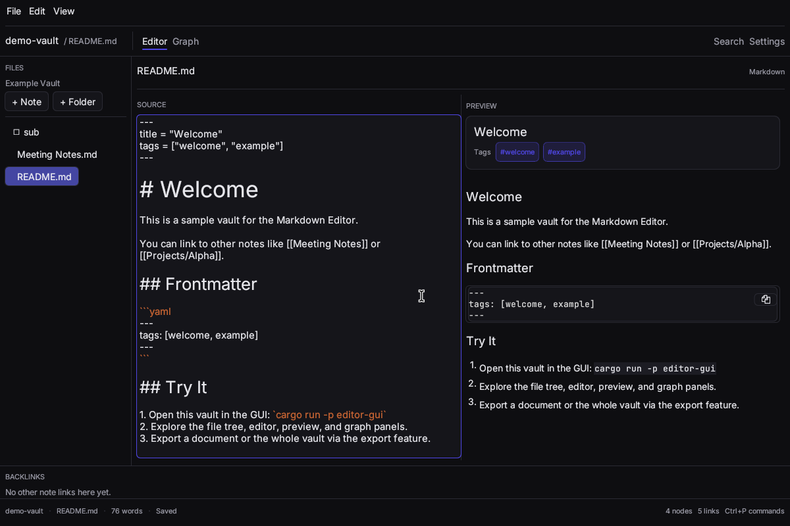

# Weft

A local-first Markdown vault: a folder of plain files you own, with a fast
editor, a live wikilink graph, backlinks, and full-text search. Desktop UI is
built with **eframe/egui**; storage, parsing, graph, search and export live in
a separate, GUI-independent core crate.

> **Status:** M4 in progress. The workspace now opens notes in tabs, keeps
> unsaved buffers per tab, and restores the session from
> `<vault>/.weft/workspace.toml`. M3's design system, YAML/TOML frontmatter,
> live link graph, backlinks, full-text search, and background watcher are all
> still in place. See [docs/roadmap.md](docs/roadmap.md) for what comes next.



## Features

- **Vaults:** open a folder of Markdown files; the last vault reopens on
  launch with its open tabs, active tab, and split intact.
- **Tabs:** several notes open at once, each keeping its own unsaved buffer, so
  switching or closing never silently drops edits. `Ctrl+W` closes,
  `Ctrl+Tab` cycles, `Ctrl+Shift+T` reopens the last closed tab, and the tab
  context menu closes others or everything to the right.
- **Split panes:** View > Split Right or Split Down opens a second pane, and
  the tab context menu moves a tab across. Each pane has its own tab strip,
  editor buffer, preview divider, caret, and back/forward history; a click
  moves keyboard focus, the accent dot marks the focused pane, and View >
  Close Pane merges the panes back into one. The divider is draggable, and the
  layout is restored on launch.
- **Editor:** syntax-highlighted Markdown editing with configurable font size,
  dirty-state indicator, and save-on-demand or timed auto-save. Editor and
  graph share one window through tabs. Each tab remembers its caret and scroll
  position, and breadcrumbs in the header show `vault / folder / note.md`.
- **Navigation:** per-pane back and forward on `Alt+Left`/`Alt+Right`, the
  mouse back/forward buttons, or View > Back/Forward. Each step carries the
  caret and scroll, so going back returns to where you were.
- **Design:** dark-first indigo palette with neutral surfaces, a matching light
  theme, and true system-theme following. Bundled Inter and JetBrains Mono,
  shared cards/tabs/empty states, styled scrollbars and selection, and a
  persistent status bar with vault, note, word count, save state, and graph
  stats.
- **Preview:** rendered Markdown via `egui_commonmark`, with frontmatter shown
  as a metadata card. Drag the divider to resize editor and preview.
- **File tree:** nested folders with expand/collapse and a context menu for
  new notes/folders, rename, move-to-trash, and reveal-in-file-manager.
  Deletions use the system trash, with a `.weft/trash/` fallback.
- **File recovery:** before a save overwrites a note, its previous contents
  are kept under `.weft/history/` (newest 20 per note). **File > File
  Recovery...** lists them with a preview and restores the chosen version into
  the editor, so a bad overwrite is one save away from being undone.
- **Graph:** a force-directed graph whose edges are wikilinks, with
  degree-sized nodes, arrowheads, hover tooltips, community colouring
  (toggleable), and draggable layout persisted to
  `<vault>/.editor/layout.json`. Links to missing notes appear as grey
  placeholders; clicking one creates and opens the note.
- **Backlinks:** a panel listing notes that link to the open document;
  clicking one opens it.
- **Quick switch:** `Ctrl+O` opens a fuzzy note list (open tabs first, then the
  whole vault). Type a few characters of the name or path, arrow through the
  matches, and press Enter.
- **Outline:** View > Outline opens a side panel listing the note's headings,
  indented by level and updated as you type. The section holding the caret is
  highlighted; clicking a heading scrolls the editor to it; a filter box
  narrows the list.
- **Find and replace:** `Ctrl+F` opens a find bar over the editor with match
  count, case toggle, Previous/Next (wrapping), Replace, and Replace all. Vault
  search moved to `Ctrl+Shift+F`.
- **Search:** full-text vault search (tantivy) with snippets and arrow-key /
  Enter navigation. Frontmatter tags are indexed; `#tag` narrows a search, and
  a tag on its own lists every note carrying it.
- **Live updates:** a background watcher applies external edits to the graph
  and index, reloads clean buffers, and shows a conflict banner instead of
  overwriting unsaved edits.
- **Frontmatter:** TOML (`key = value`) or YAML (`key: value`) blocks, including
  block tag lists. Parsing is tolerant and the raw block is preserved on save.
- **Export:** a note to standalone HTML (with escaped titles), or the whole
  vault to a bundle.
- **Shortcuts:** `Ctrl/Cmd+S` save, `Ctrl/Cmd+N` or `Ctrl/Cmd+T` new note,
  `Ctrl/Cmd+W` close tab, `Ctrl/Cmd+Tab` next tab,
  `Ctrl/Cmd+Shift+T` reopen closed tab, `Alt+Left`/`Alt+Right` back and
  forward, `Ctrl/Cmd+O` quick switch, `Ctrl/Cmd+Shift+O` open vault,
  `Ctrl/Cmd+F` find in note, `Ctrl/Cmd+Shift+F` search vault,
  `Ctrl/Cmd+P` command palette, `Ctrl/Cmd+G` graph,
  `Ctrl/Cmd+Shift+P` export note, `Ctrl/Cmd+Shift+B` export vault.

## Workspace

| Crate | Description |
| --- | --- |
| `weft-core` | Vault CRUD, markdown/frontmatter parsing, link graph, layout, search index, file watching, export |
| `weft-gui` | Desktop GUI (eframe/egui): file tree, editor, preview, graph, search |
| `weft-cli` | Command-line tool to initialise vaults and manage markdown files |

## Getting started

Requires a stable Rust toolchain (edition 2024, so Rust 1.85 or newer).
Install via [rustup](https://rustup.rs/).

```bash
# Build everything
cargo build --workspace

# Run the desktop app
cargo run -p weft-gui

# Install both binaries (`weft` and `weft-cli`) into ~/.cargo/bin
cargo install --path crates/weft-gui
cargo install --path crates/weft-cli

# Run the CLI
cargo run -p weft-cli -- --help
```

### CLI examples

```bash
# Initialise a vault
cargo run -p weft-cli -- init /path/to/my_vault

# Vault-relative paths (recommended)
cargo run -p weft-cli -- --vault /path/to/my_vault create notes/hello.md --content "# Hello"
cargo run -p weft-cli -- --vault /path/to/my_vault read notes/hello.md
cargo run -p weft-cli -- --vault /path/to/my_vault list

# Without --vault, a note path is resolved from its own parent directory
cargo run -p weft-cli -- create /path/to/my_vault/note.md --content "# Hello"
cargo run -p weft-cli -- list /path/to/my_vault
```

Paths that escape the vault (`..`, absolute paths outside the root) are
rejected.

## Vaults

A vault is a directory of markdown files with an optional `vault.toml`
config:

```toml
name = "My Vault"
extensions = ["md", "markdown"]
```

Documents may begin with TOML or YAML frontmatter:

```markdown
---
title: "My note"
tags:
  - rust
  - notes
---

# Body
```

```markdown
---
title = "My note"
tags = ["rust", "notes"]
---

# Body
```

Unknown keys are kept in `Frontmatter::other`, and malformed blocks are ignored
rather than rejecting the note. The GUI saves the buffer verbatim, so the
original dialect and formatting stay intact.

Wikilinks (`[[other-note]]`, `[[path/to/note|alias]]`) become edges in the link
graph. Targets resolve as an exact relative path, with `.md` appended, then by
case-insensitive path or file stem, and finally from the vault root. Links whose
target does not exist yet are kept as grey placeholder nodes and turn into real
notes when the file is created.

## Development

The repository treats formatting, lints and tests as gates:

```bash
cargo fmt --all --check
cargo clippy --workspace --all-targets -- -D warnings
cargo test --workspace
```

CI runs the same three commands on pushes and pull requests
(`.github/workflows/ci.yml`). Design notes and the module map live in
[docs/architecture.md](docs/architecture.md); the next milestones are in
[docs/roadmap.md](docs/roadmap.md). Layout benchmarks cover 100, 500, and 1000
nodes: `cargo bench -p weft-core`.

### Layout

```
crates/
  weft-core/
    src/
      document.rs      document model, TOML/YAML frontmatter
      parser.rs        markdown parsing, wikilinks, frontmatter splitting
      graph.rs         link graph
      graph_queries.rs path/reachability/centrality queries
      graph_updater.rs incremental graph updates from watch events
      layout.rs        force-directed layout
      layout_store.rs  persisted node positions
      vault.rs         vault config + file operations
      watcher.rs       debounced filesystem watching
      index.rs         tantivy full-text search
      export.rs        single-document / vault export
  weft-gui/
    src/
      app.rs           application state, toolbar, status bar, dialogs
      theme.rs         design tokens, light/dark/system, bundled fonts
      settings.rs      user preferences
      event_bus.rs     cross-panel event dispatch
      panels/          file tree, editor split, preview, graph, search, backlinks
      widgets/         chrome widgets, markdown editor, highlighter, graph canvas
  weft-cli/
    src/main.rs        clap-based CLI
```

## Export

`weft-core` exposes:

- `weft_core::export::export_document(vault, doc_path, output_path)` —
  renders a single document to a self-contained HTML file.
- `weft_core::export::export_vault_bundle(vault, output_dir)` — copies every
  markdown file in the vault (plus `vault.toml`) into an output directory.

## License

MIT. See [LICENSE](LICENSE).
